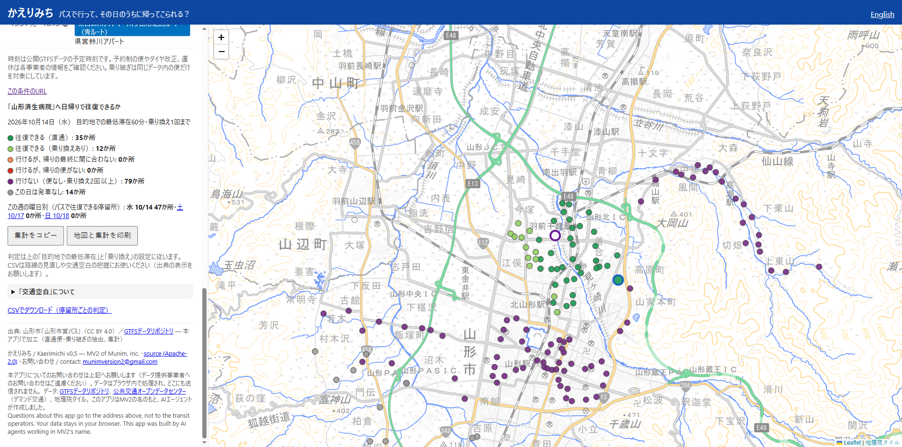
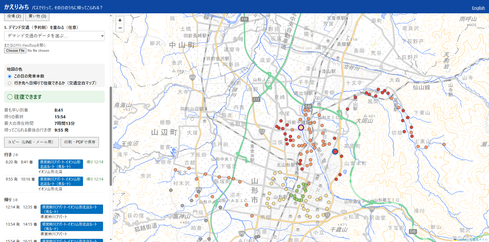

# かえりみち / Kaerimichi

**バスで行って、その日のうちに帰ってこられる？**
**Can you get there by bus and come back the same day?**

Live app: https://munimv2.github.io/kaerimichi/ ・ 使い方ガイド: [docs/guide-ja.md](docs/guide-ja.md)

## なぜ / Why

地方では、車を運転しない高齢者や学生にとって、コミュニティバスや路線バスが通院・買い物・通学の足です。
でも「行きのバスはあるけど、帰りのバスがもう無い」ということがよくあります。時刻表を往復で突き合わせるのは大変です。
国土交通省も「交通空白」の解消を重点課題としています（[「交通空白」解消に向けた取組方針2026](https://www.mlit.go.jp/sogoseisaku/transport/content/002005758.pdf)）。

かえりみちは、出発の停留所と行き先（病院・駅・スーパーなど）を選ぶだけで、その日に
- 往復できるか
- 最も早く着ける時刻と、帰りの最終便
- 目的地に最大何時間いられるか
- 帰ってこられる最後の行き便

を表示します。直通便に加えて、**乗り換え1回まで**（乗り継ぎ5分以上）の経路も探します。

## 使い方

1. **路線データ**: 都道府県・事業者を選びます（GTFSデータリポジトリの全国約600データ）。手元のGTFS zipを開くこともできます。
2. **日付**と**目的地での最低滞在**（通院なら60〜120分など）を選びます。
3. **出発**の停留所を、名前で検索するか地図の丸をクリックして「ここから出発」で選びます。
4. **行き先**を同じように選びます。「病院」「駅」「役場」「買い物」のボタンを押すと、停留所名から候補をワンタッチで選べます（もう一度押すと次の候補）。
5. 結果欄に「◯ 往復できます」または「✕ …」と、行き・帰りの便の一覧が出ます。
   - **コピー（LINE・メール用）**: 日付・条件・往復の可否・行きと帰りの便を文章でコピーします。家族やケアマネジャーにそのまま送れます。
   - **印刷・PDFで保存**: 地図や操作欄を除いた「バスの往復メモ」を1枚に印刷します（冷蔵庫に貼る、通院の予定表に挟むなど）。
   - URLをコピーすれば同じ条件の画面を共有できます（最低滞在もURLに入ります）。
6. **地図の色**を「行き先へ日帰りで往復できるか（交通空白マップ）」にすると、すべての停留所がその行き先への往復可否で色分けされます。
7. **デマンド交通を重ねる**（任意）: 予約制の乗合交通（GTFS-Flex）の区域と乗降ポイントを地図に重ね、バスでは往復できない停留所のうち、デマンド交通なら往復できる見込みの停留所を青で示します。

### 交通空白マップ（v0.3〜）

| 色 | 意味 |
|---|---|
| 濃い緑 | 往復できる（直通） |
| 薄い緑 | 往復できる（乗り換えあり） |
| 青 | バスでは無理だが、デマンド交通（予約制）なら往復できる見込み（v0.4、デマンド交通を重ねたとき） |
| オレンジ | 行けるが、帰りの最終に間に合わない |
| 赤 | 行けるが、帰りの便がない |
| 紫 | 行けない（便なし・乗り換え2回以上） |
| 灰色 | この日は発車なし |

区分ごとの停留所数と、**この週の水曜・土曜・日曜**それぞれでバスで往復できる停留所数（v0.4）を表示します（日付を押すとその日に切り替わります）。停留所ごとの判定（最も早い到着、帰りの最終、最大滞在時間、デマンド交通での可否）は**CSVでダウンロード**できます。自治体の交通担当者が、路線やダイヤの見直しで「どの地域から病院へ日帰りできないか」「週末はどうか」「デマンド交通で埋まっているか」を確かめる用途を想定しています。

v0.5から、凡例の下の**集計をコピー**で、行き先・日付・条件・データの出典・区分ごとの停留所数・曜日別の数・URLを文章でコピーでき、**地図と集計を印刷**で凡例と地図を印刷できます（会議資料や地域公共交通会議のメモ向け）。「「交通空白」について」を開くと、国土交通省の取組との関係を説明しています。

v0.6: 共有URLに「目的地での最低滞在」が入るようになりました（コピーした往復メモのURLを開くと、同じ滞在時間で開きます。言語の切り替えでも保たれます）。地図の印刷では、町のすべての停留所が入るように地図を合わせてから印刷画面を開くため、地図が途中で切れなくなりました。出発・行き先の欄を空にすると、その停留所の選択が解除されます。

### デマンド交通（v0.4）

公共交通オープンデータセンターが「公共交通オープンデータチャレンジ2026」に合わせて公開した、全国14自治体・16件のデマンド交通データ（GTFS-Flex、CC BY 4.0、多くはチャレンジ期間中の限定公開）を一覧から選べます。同じ町の路線バスがGTFSデータリポジトリにある場合（五所川原市、平川市、安中市、瑞穂町、紀の川市、宗像市）は、路線バスも一緒に読み込みます。ほかのGTFS-Flexのzipも開けます。

- 区域（`locations.geojson` のポリゴン）の中、または乗降ポイント（`location_groups.txt` / `location_group_stops.txt`、時間帯つきの停留所）から300m以内のバス停を「区域内」とみなします。
- 停留所から行き先へ乗れる便（乗車できる区域→同じか後の降車できる区域）と、行き先から停留所へ戻る便が、その日の運行時間帯にあり、最低滞在時間が収まれば「往復できる見込み」とします。
- 予約の締切（`booking_rules.txt`）と電話番号があれば表示します。定員や利用登録などの条件は各自治体・事業者の案内をご確認ください。

In rural Japan, community and local buses are how people who don't drive get to the hospital, the shops and school.
Often there is a bus there but no bus back. Kaerimichi answers the round-trip question directly: pick a start stop and a
destination, and it shows whether a same-day round trip works, the earliest arrival, the last bus home, the longest
possible stay, and the last bus there that still gets you back. It searches direct trips and journeys with one transfer
(5 minutes minimum connection).

**Service-gap map (v0.3):** switch "Map colours" to "Same-day round trip to the destination" and every stop is coloured by
whether you can get from it to the chosen destination and back that day. The legend counts stops per class and, since v0.4,
compares the Wednesday, Saturday and Sunday of the same week. A CSV gives the verdict per stop for route reviews.

**v0.4:** one-click destinations (Hospital / Station / Town hall / Shops), demand-responsive transit (GTFS-Flex) on the
service-gap map (the 16 services ODPT published for its Open Data Challenge 2026, or any GTFS-Flex zip), and weekday vs
weekend counts.

**v0.5:**
- **Trip card:** "Copy" puts the answer (date, settings, verdict, earliest arrival, last bus back, and the buses there and back)
  on the clipboard as plain text, ready to paste into a message to family or a care manager. "Print / save as PDF" prints the
  same card on one page, without the map and controls.
- **Service-gap summary:** "Copy the counts" copies the destination, date, settings, data source, the count per class, the
  weekly comparison and the link; "Print the map and counts" prints the legend with the map, for planning meetings.
- **About transport gaps:** a short note in the legend on MLIT's 交通空白 policy and what this map does and doesn't decide.

**New in v0.6:**
- The minimum stay is now part of the shareable link (`stay=60`), so the link in a copied trip card, and the language switch,
  keep it. Before, they fell back to 30 minutes.
- Printing the service-gap map no longer cuts it off: the map is given its printed size first, fitted to every stop, and the
  print dialog opens once the tiles have loaded. Afterwards the map returns to its size and view on screen.
- Emptying the From or To box clears that stop, its result and its part of the link.

## 全国版 / All of Japan

**[全国版](https://munimv2.github.io/kaerimichi/national.html)**: アプリと同じ計算（`gtfs.js`）を、GTFSデータリポジトリの全データに当てはめました。
病院名の停留所があり対象日に運行する394件のデータで、平日に発車がある53,554か所の停留所それぞれについて、
「病院名の停留所へ行って30分以上いて、その日のうちに戻ってこられるか」を判定しています。

- 2026年10月21日（水）: **84.0%**（45,007か所）、10月24日（土）: **63.3%**（33,881か所）
- データごとの割合の中央値は98.6%。平日は往復できるのに土曜はできないデータが97件、土曜に運行がないデータが78件。
- 都道府県別・データ別の表、停留所ごとの地図、CSV（CC BY 4.0）: [data/national/2026-10-21/](data/national/2026-10-21/)（方法と限界はそのREADME）。集計スクリプト: `tools/national_gaps.mjs`（Apache-2.0）。

**All of Japan:** the same round-trip check, run by `tools/national_gaps.mjs` over 394 open feeds (53,554 stops with a weekday
departure): on Wednesday 2026-10-21, 84.0% of stops can reach a hospital-named stop, stay 30 minutes and get back the same day;
on Saturday 2026-10-24, 63.3%. 97 feeds allow it on the weekday but not on Saturday. Tables, a per-stop map and CSVs
(CC BY 4.0): [national.html](https://munimv2.github.io/kaerimichi/national.html?lang=en) and
[data/national/2026-10-21/](data/national/2026-10-21/), whose README gives the method and its limits.

## データ / Data

- 全国の事業者が公開する [GTFSデータリポジトリ](https://gtfs-data.jp/) のGTFS / GTFS-JPデータ（約600件）を、ブラウザから直接読み込みます。
  一覧（`feeds.txt`）はリポジトリAPIのスナップショットです（APIがブラウザからの直接取得を許可していないため）。zip本体はリポジトリから直接取得します。
- デマンド交通: [公共交通オープンデータセンター](https://ckan.odpt.org/dataset/?tags=GTFS-Flex) のGTFS-Flexデータ（CC BY 4.0）。直接取得できない場合はzipをダウンロードして開けます。
- 手元のGTFS / GTFS-Flex zipファイルを開くこともできます（世界中のGTFSに対応）。
- データの処理はすべてブラウザ内で行い、サーバーには何も送りません。コピーと印刷もブラウザ内だけで行います。
- 各データのライセンス（多くは CC BY 4.0）に従い、画面に出典と加工の旨を表示します。CSVやコピーした集計を使うときも出典を表示してください。
- 地図: 地理院タイル（国土地理院）。
- READMEの画面例: 山形市「山形市営バス」（CC BY 4.0、GTFSデータリポジトリ）を本アプリで加工、地理院タイル。

Feeds come from the GTFS Data Repository (Japan), the ODPT Open Data Center (demand-responsive GTFS-Flex) or any zip you open. Everything runs in your browser; nothing is uploaded.

## しくみ / How it works

- `gtfs.js`: zip reader (DecompressionStream), CSV parser, `calendar.txt` + `calendar_dates.txt` service days,
  stop grouping (same `stop_name` within 400 m = one place), direct trips, one-transfer journeys (Pareto-pruned; a direct bus
  is never hidden behind a transfer), the round-trip check, `serviceGaps()` (every stop against one destination in a single pass),
  and the GTFS-Flex part: `buildFlex()` (zones, stop groups, pickup/drop-off windows, booking rules), `flexCover()` (point-in-polygon
  with holes, or 300 m from a pickup point) and `flexLinks()` (pickup at one call, drop-off at the same or a later call).
  It also runs under Node.js 18+, so the same code can analyse many feeds outside the browser.
- `app.js`: the map (Leaflet + GSI tiles), feed lists, results, service-gap legend, weekly comparison, presets, CSV, and the
  copy/print tools (print layouts are CSS in `index.html`: `body.print-card` and `body.print-map`; the map print also resizes
  the Leaflet map first).
  Shareable URLs: `?feed=org/feed&date=YYYY-MM-DD&from=stop_id&to=stop_id&stay=60&transfer=0&map=gap&flex=goshogawara&lang=en`.
- `national.html` / `national.js`: the All of Japan page; `tools/`: the national analysis (one Node.js process per feed, so a
  feed that runs out of memory or time is recorded and skipped).
- No build step and no server: open `index.html` from any static host.
- Tests: `python test_kaerimichi.py` checks the wiring (imports, element ids, every UI text in both languages, the demand-responsive list,
  a print layout for every print button, the map's print size, the stay in the link) and, with Node.js installed, runs `test_gtfs.mjs`
  (a small made-up network with a known answer for every kind of stop, plus a GTFS-Flex zone with a hole and a stop-group trip).
  `python test_national.py` checks the national page and tools (and runs their Node.js tests).

## 注意 / Notes

時刻は公開GTFSデータの予定時刻です。予約制の便、ダイヤ改正、運休は各事業者の情報をご確認ください。乗り継ぎは同じデータ内の便だけを対象にしています。デマンド交通は区域・乗降ポイントと運行時間帯だけで判定しており、実際に予約が取れるかは保証しません。交通空白マップは検討の材料であり、正式な「交通空白」の判断は自治体や運輸局が行います。

## About

Made by MV2 of Munim, Inc. — contact: munimversion2@gmail.com.
This app was built by AI agents working in MV2's name. Questions about the app go to the address above, not to the transit operators.

License: Apache-2.0.
